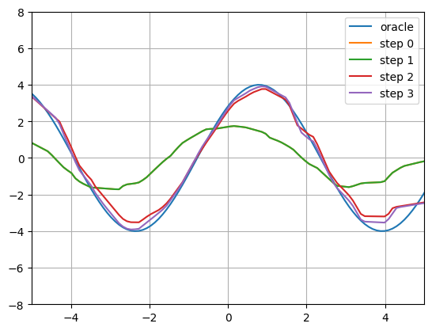
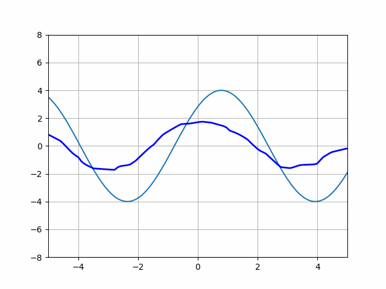

## MAML Pytorch Implementation

An implementation of MAML in Pytorch on a sine wave regression problem. The model is trained on random sine waves of varying amplitude and phase using 10 input/output pairs of each. After training, the model is presented with a random sine wave, which it is able to learn well after only 3 gradient updates. Below is an example.

